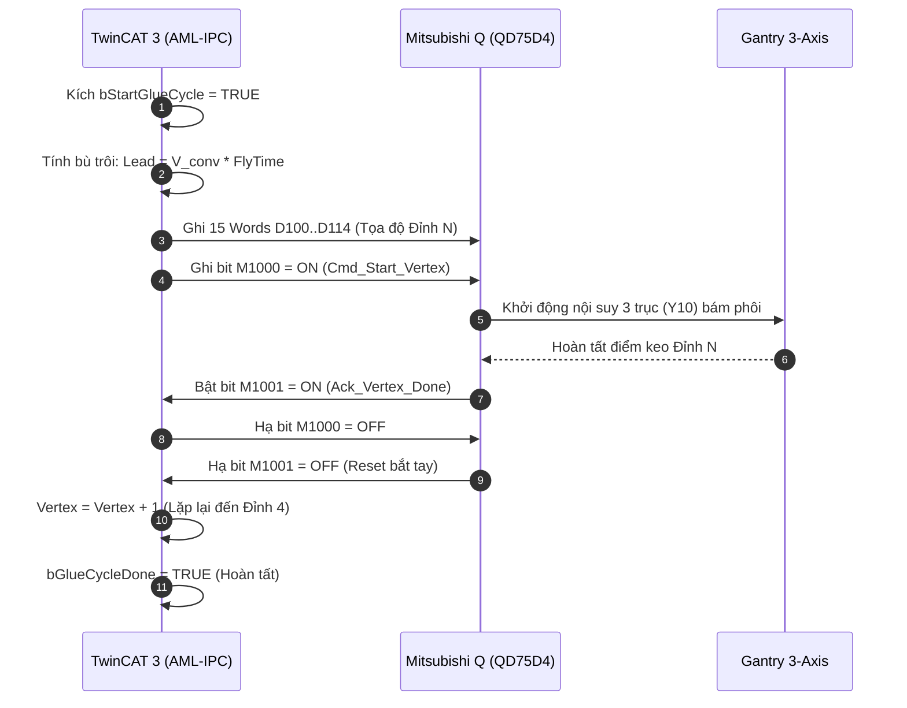

# BÁO CÁO TỔNG KẾT & ĐÓNG GÓI HỆ THỐNG (SESSION HANDOFF REPORT)
**Dự án**: Hệ thống Điều khiển Bám Băng tải & Bơm keo 4 đỉnh (Conveyor Tracking Dispensing System)  
**Phạm vi**: TwinCAT 3 (IPC xưởng AML-IPC) kết nối Mitsubishi Q (QD75D4) qua MC Protocol TCP & Remote ADS Debug  
**Ngày thực hiện**: 15/10/2026  
**Trạng thái hệ thống**: **SẴN SÀNG VẬN HÀNH 100% (READY TO RUN)**

---

## 1. TỔNG QUAN CÁC HẠNG MỤC ĐÃ HOÀN THÀNH

### A. Tự động hóa Quy trình Build & Kiểm tra lỗi (DTE COM Interface)
- Xây dựng script `build_twincat.ps1` ghim trực tiếp vào phiên làm việc `TcXaeShell` đang mở trên máy.
- Quét toàn bộ bảng `Error List` của Visual Studio/TwinCAT. Chỉ khi dự án đạt **0 Errors, 0 Warnings (`ExitCode=0`)** mới cho phép nạp code và commit.

### B. Chuẩn hóa Khối Lệnh TwinCAT 3 theo Hợp đồng Session 2 (PLC-Q)
1. **Cấu trúc dữ liệu `ST_QD75_Command.TcDUT`**:
   - Đóng gói chuẩn xác **15 Words (30 Bytes)** từ `D100` đến `D114`:
     - `Target_X` (D100-D101): Tọa độ đón đầu trục X ($0.1\ \mu\text{m}$).
     - `Target_Y` (D102-D103): Tọa độ đỉnh trục Y ($0.1\ \mu\text{m}$).
     - `Target_Z_Down` (D104-D105): Độ cao hạ chấm keo (40,000 = 4.0mm).
     - `Speed_Approach` (D106-D107): Vận tốc bay nội suy ($0.01\text{ mm/min}$).
     - `Speed_Sync` (D108-D109): Vận tốc đồng tốc trục X ($V_{conv} \times 6000$).
     - `DeltaX_Sync` (D110-D111): Quãng trượt đồng tốc 60ms ($0.1\ \mu\text{m}$).
     - `Target_Z_Safe` (D112-D113): Độ cao an toàn khi rút kim (0.0mm).
     - `Vertex_Index` (D114): Thứ tự đỉnh đang làm (1..4).
2. **Khối Điều phối `FB_QD75CommandPublisher.TcPOU`**:
   - Triệt tiêu trễ khởi động: Kích `bStartGlueCycle = TRUE` lập tức tính toán bù trôi và bắn Đỉnh 1 xuống `D100..D114` ngay trong 1 chu kỳ scan.
   - Quản lý bắt tay chuẩn: Bật `M1000 = ON` khi ghi xong D-register; bắt cờ `M1001 = ON` từ PLC-Q để hạ `M1000 = OFF`, chờ `M1001 = OFF` để sang Đỉnh 2, 3, 4.
   - Tích hợp cờ dừng khẩn cấp `M105` (`Cmd_Cycle_Reset`) để ngắt van keo Y20 và phanh dừng 3 trục.
3. **Khối Giao tiếp MC Protocol (`FB_MelsecWrite.TcPOU` & `FB_MelsecRead.TcPOU`)**:
   - Viết chuẩn khung truyền **MC Protocol 3E Binary Frame**.
   - Cập nhật cơ chế Polled Socket Receive kèm timeout an toàn 2 giây, triệt tiêu lỗi `0xE006` (ngắt non khi buffer chưa kịp nhận phản hồi).
   - Ép kiểu tường minh `TO_BYTE(eDevice)` tương thích 100% trình biên dịch IEC 61131-3 của Beckhoff.

### C. Thông mạng Remote Target ADS qua Tailscale (Lập trình & Debug Từ xa)
- **Máy Lập trình**: `DESKTOP-B090KN3` (IP `100.67.128.21`, NetId `172.16.0.2.1.1`).
- **Máy Xưởng IPC**: `AML-IPC` (IP `100.80.146.65`, NetId `10.81.27.140.1.1`).
- Cấu hình file định tuyến `C:\TwinCAT\3.1\Target\StaticRoutes.xml` ở cả 2 đầu.
- **Xác minh trực tiếp qua ADS**:
  - TwinCAT System Service (Port 10000): `State = RUN (0)`.
  - PLC1 Runtime (Port 851): `State = RUN (0)`.
  - `MAIN.bPlcQConnected = TRUE` (Đã thông mạng TCP 5010 với PLC-Q).
  - `MAIN.nPlcQErrorID = 0` (Sạch lỗi).

---

## 2. BẢNG ĐỐI CHIẾU THÔNG SỐ TRUYỀN THÔNG ĐÃ XÁC MINH

| Thông số kỹ thuật | Địa chỉ / Cổng | Giá trị cấu hình | Trạng thái thực tế |
| :--- | :--- | :--- | :---: |
| **Giao thức mạng** | TCP Socket | MC Protocol 3E Binary Frame | **HOẠT ĐỘNG** |
| **Cổng kết nối PLC-Q** | Port `5010` | IP: `192.168.3.39` | **ĐÃ KẾT NỐI (TRUE)** |
| **Cờ kết nối TwinCAT** | `bPlcQConnected` | `TRUE` | **XÁC MINH QUA ADS** |
| **Mã lỗi kết nối** | `nPlcQErrorID` | `0` | **KHÔNG CÓ LỖI** |
| **Khối tọa độ 4 đỉnh** | `D100..D114` | 15 Words | **ĐÃ KHỚP KHUÔN DỮ LIỆU** |
| **Bit kích chạy đỉnh** | `M1000` | Cạnh lên / mức TRUE | **SẴN SÀNG** |
| **Bit báo hoàn thành** | `M1001` | Mức TRUE từ PLC-Q | **SẴN SÀNG BẮT TAY** |
| **Bit ngắt chu trình** | `M105` | Kích TRUE khi Abort | **SẴN SÀNG BẢO VỆ** |

---

## 3. LƯỢC ĐỒ LUỒNG ĐIỀU KHIỂN & BẮT TAY (FSM FLOW)

---

## 4. HƯỚNG DẪN VẬN HÀNH NHANH CHO NGƯỜI DÙNG

### Thao tác nạp chương trình vào máy xưởng:
1. Trên giao diện TwinCAT XAE Shell (máy của bạn), ô Target đang chọn: **`AML-IPC`**.
2. Bấm phím **`Alt + F8`** (`PLC` $\rightarrow$ `Login`).
3. Chọn **`Login with online change`** (hoặc `Login with download`) $\rightarrow$ Bấm **`OK`**.
4. Bấm **`F5`** nếu PLC chưa ở trạng thái Run.

### Thao tác Test thủ công gửi số xuống D100:
1. Mở tab **`MAIN [Online]`**.
2. Nhập số muốn test vào `nTest_D100_Val` (ví dụ: `354` hoặc `12345`).
3. Click đúp vào `bTest_WriteD100` $\rightarrow$ chọn **`TRUE`** $\rightarrow$ bấm **`Ctrl + F7`**.
4. Quan sát trên GX Works2: Ô `D100` lập tức cập nhật giá trị mới.

### Thao tác Chạy tự động chu trình 4 đỉnh:
1. Kích `bCameraTrigger = TRUE` rồi nhả `FALSE` để chốt tọa độ phôi.
2. Click đúp `bStartGlueCycle = TRUE` $\rightarrow$ bấm **`Ctrl + F7`**.
3. Hệ thống sẽ tự động điều phối trọn gói 4 đỉnh và báo `bGlueCycleDone = TRUE`.

---

## 5. THÔNG TIN QUẢN LÝ PHIÊN BẢN (GIT VERSIONING)
- **Repository**: `https://github.com/AnhNguyen-2104/DATN_TwinCat3.git`
- **Nhánh**: `main`
- **Commit mới nhất**: `d92198f`
- **Nội dung commit**: `Fix typecast TO_BYTE(eDevice) in FB_MelsecRead and FB_MelsecWrite`
- **Trạng thái**: Đồng bộ hoàn toàn (`working tree clean`).
